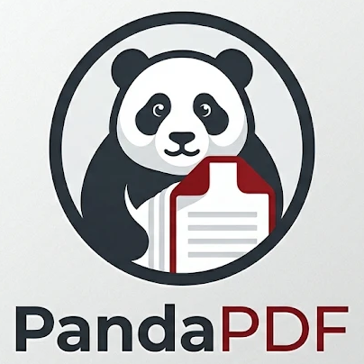

<p align="center">
  
</p>

<h1 align="center">PandaPDF</h1>

<p align="center">
  <b>Lightweight and lightning-fast PDF manipulation for seamless document management.</b><br>
  Read, organize, combine, split and secure PDFs in a fast, native app written in Rust.<br>
  Windows · macOS · Linux
</p>

<p align="center">
  
  
  
</p>

---

PandaPDF is based on [PdfCraft](https://github.com/storytold/pdfcraft) by the ArtCraft team and the
PdfCraft contributors. It keeps PdfCraft's engine and adds its own name, logo and links.

## What it does

- **Read** with care for typography: world scripts, vertical Japanese, colour emoji, transparency,
  layers. Deep zoom stays sharp, and damaged files are repaired rather than crashing.
- **Find** as you type, and copy text in the right reading order, columns and right-to-left included.
- **Organize** pages: rotate, delete, insert, move, extract. Undo goes all the way back, even after saving.
- **Combine and split** documents while keeping links, form fields, layers and attachments.
- **Protect**: open and save encrypted documents (40-bit RC4 to AES-256) and honour their permissions.
- **Forms, comments and attachments**: fill forms, read threaded comments, open attachments.
- **Safe saves**: every save is incremental and atomic, and the original bytes stay intact.
- **Private**: no account, no telemetry, no cloud. Documents never leave your computer.

## Command line and automation

`pdfcraft-cli` covers inspecting, rendering, extracting text, editing, combining and splitting:

```sh
pdfcraft-cli combine report.pdf appendix.pdf --out combined.pdf
pdfcraft-cli extract report.pdf --pages 1,3,5-8 --out highlights.pdf
pdfcraft-cli split   report.pdf --every 10 --out-dir parts/
pdfcraft-cli text    paper.pdf --page 3
pdfcraft-cli tools                       # every automation tool and its JSON Schema
```

`pdfcraft-cli mcp --root DIR` is an opt-in MCP server for AI agents. It talks over stdin/stdout,
opens no network port and only touches files under `--root`.

## Build

Building needs Rust 1.95 or later (and, on Windows, the Visual Studio C++ Build Tools).

```sh
git clone https://github.com/ganeshpanda/PandaPDF
cd PandaPDF
cargo run --release -p pdfcraft -- some.pdf     # the desktop app
```

The app binary is `target/release/pdfcraft` (`pdfcraft.exe` on Windows). The crate and binary
names are still PdfCraft's, so the code stays easy to compare and merge with upstream.

Development notes (logs, environment variables, tests) are in [docs/development.md](docs/development.md).

## Feedback

Report bugs and ideas in [GitHub issues](https://github.com/ganeshpanda/PandaPDF/issues).

## License and credits

PandaPDF is dual-licensed under [MIT](LICENSE-MIT) or [Apache-2.0](LICENSE-APACHE), at your option,
like PdfCraft. Copyright notices for PdfCraft and its contributors are kept in [LICENSE-MIT](LICENSE-MIT)
and [NOTICE](NOTICE).

PandaPDF is based on [PdfCraft](https://github.com/storytold/pdfcraft) by the ArtCraft team. It is not
made, endorsed or supported by the ArtCraft team, and it carries none of their logos.

Bundled fonts, icons, images and other assets keep their own open licences; each one is listed with
its author, source and licence in [ATTRIBUTION.md](ATTRIBUTION.md). The PandaPDF logo is described in
[assets/app-icon/README.md](assets/app-icon/README.md).
